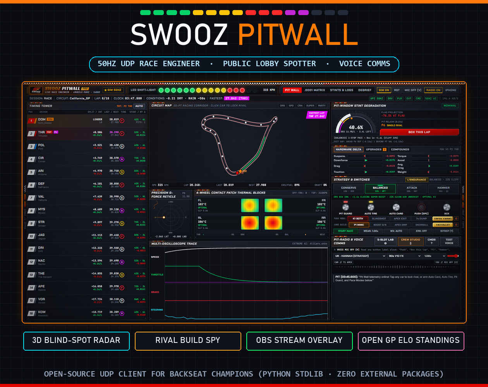

# SWOOZ PitWall — Live 50Hz Race Engineer & Telemetry Client for *Backseat Champions*

Open-source companion app built on top of [*Backseat Champions*' official 50Hz UDP Game API](https://store.steampowered.com/app/2174510/Backseat_Champions/) (`ports 29770 / 29771` + `/race-results` webhook). Runs locally on Windows using the Python standard library (`0` third-party `pip` packages required) and renders in a zero-scroll cockpit for PC monitors, slab phones, and foldable displays.

- **Try Live in Browser / Download on Itch.io:** [dom-swooz.itch.io/swooz-pitwall](https://dom-swooz.itch.io/swooz-pitwall)
- **Get *Backseat Champions* on Steam:** [store.steampowered.com/app/2174510/Backseat_Champions](https://store.steampowered.com/app/2174510/Backseat_Champions/)



---

## What's New in v2.4 — Public Lobby & Mobile Update

In *Backseat Champions*, public lobbies lock external car and menu commands (`pick_card`, `set_pit`, `pick_tire`, `boost`, `drive`) for fair play, while keeping the full 16-car 50Hz telemetry stream, `set_camera`, and host `/race-results` uploads active. **v2.4** adds a dedicated suite built specifically around what works legally in public multiplayer races:

- **Public-Lobby Fair-Play Shield & Instant Card Spotter:** Automatically detects `public_lobby = true`, disables blocked UDP commands so the game never throws `public_lobby` errors, and switches to instant audio + HUD callouts (`"Pick 2 — Pit Speed!"`) the moment an upgrade hand appears so you can press `1`–`3` yourself without looking away from the track.
- **50Hz 3D Blind-Spot Radar & Spatial Audio:** Projects nearby cars from `Motion` world coordinates into local meter offsets (`CAR LEFT`, `CAR RIGHT`, `3-WIDE`, `DIVEBOMB`) with left/right stereo ear tones via Web Audio `StereoPannerNode`.
- **Live Rival Build Spy (`SPY & CAM` Deck):** Reads live `Car Status` `.0001` performance ratios and `Car Abilities` flags across all 16 cars, alerting you over radio when the car ahead or behind unlocks **Super Boost**, **DRS**, or **Party Mode**, or holds a straight-line vs. cornering advantage.
- **Voice Camera Control & AI TV Director (`set_camera`):** Since `set_camera` remains unlocked in public lobbies, you can call `"Battle Cam"`, `"Rear View"`, `"T-Cam"`, `"Chase"`, or `"Helicopter"` hands-free, or turn on **AI TV Director** for automatic camera cuts while spectating or hosting.
- **Transparent `1920x1080` OBS Stream Overlay (`?obs=1`):** Add `http://127.0.0.1:8765/?obs=1` as an OBS Browser Source for a clean transparent timing tower, pedal/speed halo, proximity radar, and live radio subtitle strip.
- **2-Player Co-Op Engineer Link (`?role=crew`):** Open `http://<LAN-IP>:8765/?role=crew` on a second device so a friend can watch your tire cliffs, weather slope, and rival gaps and send 1-tap or custom radio callouts straight into your headset.
- **Open GP Elo & Points Leaderboard (`OPEN GP` Tab):** Point *Backseat Champions*' **Race Results** URL at `http://127.0.0.1:8765/race-results` when hosting lobbies to track FIA points, pairwise multiplayer Elo ratings, circuit/class lap records, and optional Discord webhook podium posts.
- **Slab & Foldable Mobile Modes:** Dedicated `AUTO · SLAB` bottom thumb-dock layout for narrow phones (`< 600px`) and `AUTO · FOLD` 50/50 split-screen layout for unfolded foldables in portrait/square orientation.


---

## Core Features (Single-Player & Custom API Lobbies)

- **50Hz Telemetry Cockpit:** 16-car timing tower, self-mapping 2D track corridor, 4-wheel slip/thermal blocks, G-G friction circle, 4-lane oscilloscope (`Speed`, `Throttle`, `Brake`, `Steering`), and pit-rejoin traffic calculator.
- **Local WinRT Pit-Radio Voice:** Offline Windows speech synthesis piped through a 90s V10 F1 radio bandpass/squelch chain (`0 ms` cloud wait, no API keys). Includes **Crew Studio** for recording or sharing custom `.zip` voice packs.
- **Hands-Free Voice Commands (`[V]`):** Trigger pit calls, tire compounds, pace modes, camera angles, or card picks by reading button labels aloud.
- **Single-Monitor & Zero-`Alt+Tab` Tools:** Optional foreground-gated hotkeys (`F5`–`F8`, `Mouse 4/5`, `Numpad 0–9`) active only while `BackseatChampions.exe` is focused, plus a compact `1280x136` always-on-top `MINI HUD`.
- **Optional Co-Pilot Assists (Custom/Private Lobbies Only):** `Auto Card` (calibrated against archived race logs and 5 customizable build slots), `Auto Tire`, `Pit Cliff Guard`, and 5 customizable `Push` boost macros.

---

## Quick Start (Windows)

1. Install **Python 3.10+** ([python.org](https://www.python.org/downloads/)). No `pip install` step is needed.
2. In *Backseat Champions* → **Settings → Telemetry**:
   - **Telemetry Out:** `127.0.0.1`, port `29770` (enable Driver Data, Player Data, and Decision Events).
   - **Commands In:** `127.0.0.1`, port `29771` (used for `set_camera` in public lobbies, and optional co-pilot inputs in private/offline sessions).
   - **Race Results (Optional):** `http://127.0.0.1:8765/race-results` (archives post-race results and updates the Open GP leaderboard when you host).
3. Double-click **`start_pitwall.bat`** to open the cockpit at `http://127.0.0.1:8765` (or run `enable_autolaunch.bat` once to launch automatically alongside the game).
4. Want to explore without the game open? Toggle **`SIM ON`** in the top bar to run the built-in 16-car 50Hz race simulator.

---

## Repository Layout

```text
backseat-pitwall/
├── server.py               # Asyncio HTTP/WebSocket server, UDP bridge & local WinRT TTS worker
├── engine.py               # 50Hz telemetry state, stint/undercut math & co-pilot controllers
├── public_suite.py         # 3D proximity radar, rival spy, TV director & Elo/Discord league engine
├── bc_api.py               # Binary UDP packet decoder & command builder (ports 29770/29771)
├── card_strategist.py      # Upgrade hand evaluator & archived P1 blueprint loader
├── loadout_manager.py      # 5-slot Push & Card build customizer
├── swooz_persona.py        # Custom Crew Studio voice pack recorder & .zip importer/exporter
├── simulator.py            # Standalone 50Hz 16-car race simulator for testing
├── pitwall_companion.pyw   # Frameless window helper, auto-launcher & Win32 hotkey reader
├── static/                 # HTML/CSS/Canvas UI + browser demo simulator
└── pack_release.py         # Builds single-file HTML, Web .zip, and Community .zip
```

## License

MIT License — see [LICENSE](LICENSE). Built by **Dom_Swooz** for the *Backseat Champions* community.
