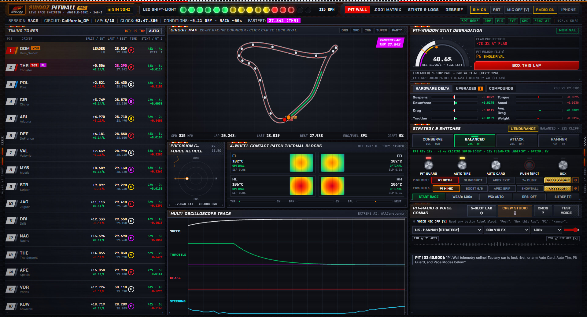
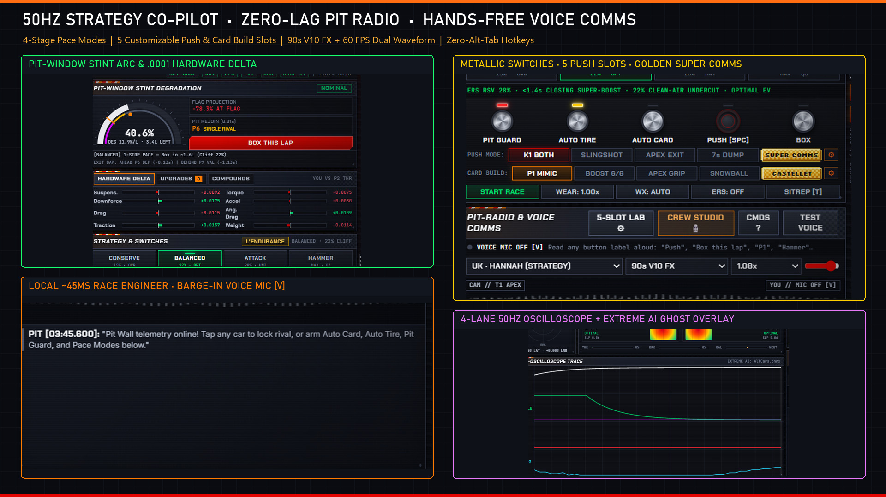
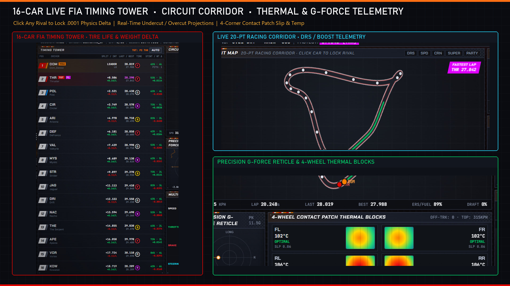
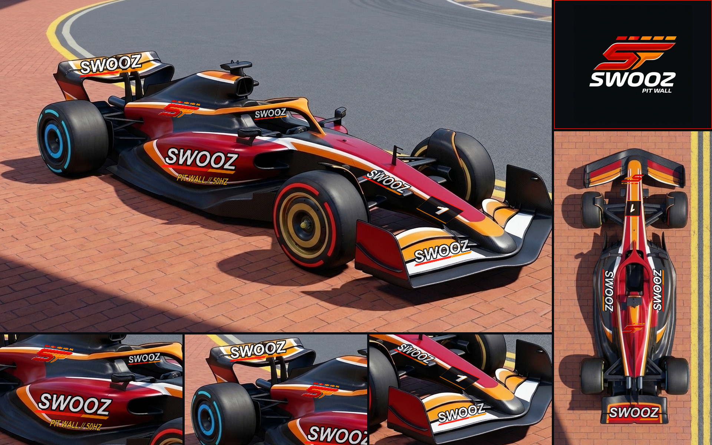
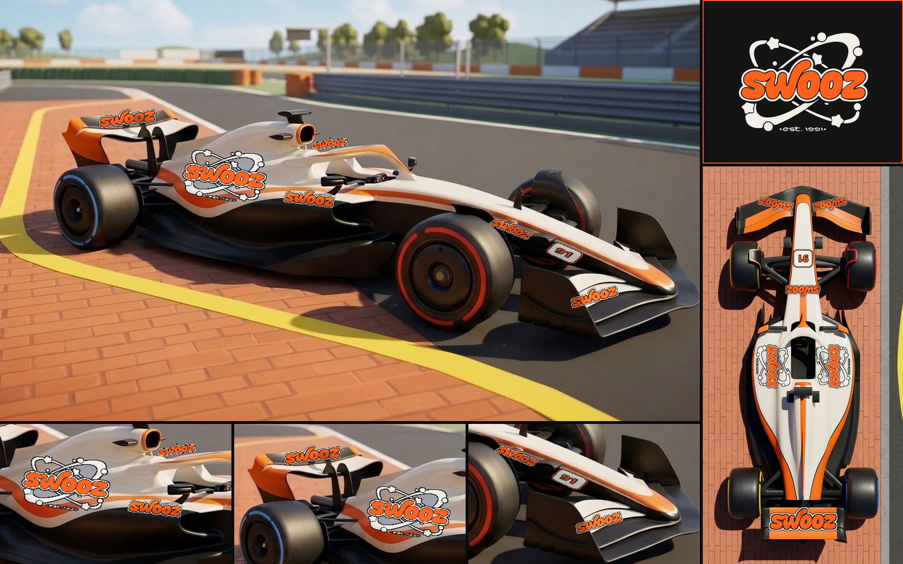

# 🏎️ SWOOZ PitWall — Live 50Hz Race Engineer & Voice Comms for *Backseat Champions*

> **Zero-lag local Pit-Radio Engineer, 50Hz F1-style Telemetry Cockpit, Hands-Free Voice Commands, Zero-`Alt+Tab` In-Game Hotkeys, and `80.7K`-Synced Extreme AI Strategy Co-Pilot.**



---

## ✨ Highlights

- **⚡ Zero-Scroll 50Hz Telemetry Cockpit** — Live 16-car Timing Tower with sector deltas & compound badges, interactive Track Corridor map, 4-wheel Tire Thermal & Wear rings, G-Force meter, live Driver vs. Rival/Extreme-AI Multi-Oscilloscope (`Pedal` + `Steer`), and real-time Undercut / Pit-Rejoin Window predictor.
- **📻 Zero-Lag Local Pit-Radio Engineer** — Powered by an offline WinRT speech daemon with pre-warmed memory cache and 90s V10 F1 radio band-pass processing (`0 ms` cloud latency, zero API keys required). Choose from multiple Race Engineer personas (**UK · Hannah**, **IE · Connor**, **US · Crew Chief**, **US · Atlas AI**).
- **🎙️ "Speak What You See" Hands-Free Voice Control** — Every strategy button, pace mode, pit call, and upgrade card on the PitWall can be triggered by voice while driving full-screen — including fuzzy headset homophone matching (`"Super Comms"`, `"Auto Card"`, `"Extreme AI"`, `"Box Box"`, `"Pick One"`).
- **🎮 Zero-`Alt+Tab` Single-Monitor Suite** —
  - **Passive In-Game Hotkeys (`F5`–`F8`, Mouse `MB4`/`MB5`, `Numpad 0–9`)** fire PitWall commands *only* while `BackseatChampions.exe` is in the foreground — never hijacking keys when typing elsewhere.
  - **`NO-ALT-TAB: ON`** automatically snaps focus back to the game ~`35 ms` after clicking any PitWall switch on a second monitor.
  - **`MINI HUD` + `PIN TOP`** collapses PitWall into a sleek `1280×136` always-on-top telemetry & radio strip for single-monitor setups.
- **🧠 `EXTREME AI` 80.7K Strategy Sync** — Calibrated against *Backseat Champions*' `80,721` Extreme AI race trees (`Quad 6/6 Facility Rush`: **Speed + Boost + Performance + Cornering** → Augment/Timed closer) with live `50 Hz` AI ghost input overlays.
- **🛠️ Custom Crew Studio (`.zip` Voice Packs)** — Record or import your own `.wav`/`.mp3`/`.ogg` radio callouts right inside the browser UI (`CREW STUDIO 🎙️`) and export/import shareable `.zip` Crew Packs with friends and leagues.
- **🎨 Bonus 9-Car Livery Builders Included** — Includes procedural 2× supersampled livery generators for **SWOOZ Works (`#1`)** and **SWOOZ Heritage `'91` (`#91`)** across all 9 *Backseat Champions* car classes.

---

## 📸 Cockpit & Livery Gallery

| Strategy Switches, Golden `SUPER COMMS` & Voice Radio | 16-Car Timing Tower, Circuit Map & 4-Wheel Thermals |
| :---: | :---: |
|  |  |

| Bonus Livery Suite: **SWOOZ Works (`#1`)** | Bonus Livery Suite: **SWOOZ `'91` Heritage (`#91`)** |
| :---: | :---: |
|  |  |

---

## 🚀 Quick Start (Windows)

### 1. Prerequisites
- **Windows 10 / 11** (uses built-in Microsoft Edge / Chrome app-window mode + native WinRT Speech Synthesis)
- **Python 3.10+** ([python.org](https://www.python.org/downloads/)) — standard library only for the live PitWall server (`0` third-party pip packages required to run!)
- **Backseat Champions** on Steam

### 2. Enable UDP Telemetry in *Backseat Champions*
In *Backseat Champions*, open **Settings → Telemetry / API** and verify:
- **UDP Telemetry Output:** `Enabled` → `127.0.0.1` port **`29770`**
- **UDP Command Input (External Assist):** `Enabled` → `127.0.0.1` port **`29771`**

*(Note: Auto-Card, Auto-Boost, and Auto-Pit commands require **External / AI Assist** to be permitted in lobby rules; PitWall will warn you over Pit Radio if a lobby blocks external commands.)*

### 3. Launch SWOOZ PitWall
- **Manual Launch:** Double-click **`start_pitwall.bat`** — opens the dedicated frameless PitWall cockpit at `http://127.0.0.1:8765`.
- **Hands-Free Steam Auto-Launch (Optional):** Double-click **`enable_autolaunch.bat`** once. A silent background watcher (`0%` CPU) will automatically open SWOOZ PitWall whenever `BackseatChampions.exe` launches and close it cleanly after you exit the game. Run **`disable_autolaunch.bat`** anytime to turn this off.
- **No Game Running? Try `DEMO SIM`:** Click **`DEMO SIM`** in the top bar anytime to stream a full 16-car Grand Prix simulation with live overtakes, tire wear, rain transitions, upgrade cards, and Pit-Radio callouts!

---

## 🎙️ Voice Commands ("Speak What You See")

Arm **`VOICE MIC ON`** in the top bar (persists automatically across launches). Speak naturally — no wake-word needed:

| Say Any Of These... | PitWall Action |
| :--- | :--- |
| **`"Super Comms"`** / **`"Golden Stack"`** | Arms the golden **★ SUPER COMMS** full co-pilot stack (`Auto Boost` + `Auto Card` + `Auto Tire` + `Auto Pit` + `Push Now`) |
| **`"Extreme AI"`** / **`"P1 Mimic"`** | Syncs Card Strategist to the **`80.7K` Extreme AI Quad-`6/6` Blueprint** |
| **`"Push"`** / **`"Overtake"`** / **`"Send It"`** | Fires active **PUSH / BOOST** macro (`K1 Super`, `Slingshot`, `Apex Exit`, etc.) |
| **`"Box Box"`** / **`"Pit This Lap"`** | Arms **PIT THIS LAP** & selects optimal dry/wet tire compound |
| **`"Cancel Pit"`** / **`"Stay Out"`** | Cancels pending pit entry (`STAY OUT`) |
| **`"Auto Card"`** / **`"Auto Upgrade"`** | Toggles **AUTO CARD** instant card-picker (`ON` / `OFF`) |
| **`"Card One"`**, **`"Card Two"`**, **`"Card Three"`** | Immediately picks Upgrade Card slot `1`, `2`, or `3` (or say the card's name!) |
| **`"Auto Tire"`** / **`"Auto Pit"`** / **`"Pit Guard"`** | Toggles automatic compound selection, automatic pit-window entry, or double-stack protection |
| **`"Pace Attack"`**, **`"Balanced"`**, **`"Conserve"`** | Switches Race Engineer target pace & boost deployment threshold |
| **`"Softs"`**, **`"Mediums"`**, **`"Hards"`**, **`"Wets"`** | Pre-selects next pit-stop tire compound |
| **`"Status"`** / **`"Sitrep"`** / **`"Tire Check"`** | Engineer reads live gap ahead/behind, tire life %, and pit window over radio |
| **`"Quiet"`** / **`"Radio Check"`** | Mutes or tests Pit-Radio Engineer voice |

---

## ⌨️ Zero-`Alt+Tab` In-Game Hotkeys

Active **only** when `BackseatChampions.exe` is the active foreground window (toggle via **`HOTKEYS: ON`** in the top bar):

| In-Game Key / Mouse Button | PitWall Command |
| :--- | :--- |
| **`F5`** / **`Mouse Button 5 (Forward)`** / **`Numpad 0`** | **PUSH NOW** (Deploy active Boost / Overtake macro) |
| **`F6`** / **`Mouse Button 4 (Back)`** / **`Numpad .`** | **BOX THIS LAP** (Toggle Pit Request + Auto-Compound) |
| **`F7`** | Toggle **AUTO CARD** (`ON` / `OFF`) |
| **`F8`** | Request **LIVE SITREP** over Pit Radio |
| **`Numpad 1` / `2` / `3`** | Pick **Upgrade Card `1` / `2` / `3`** |
| **`Numpad 4`** | Cycle **Pace Mode** (`CONSERVE` → `BALANCED` → `ATTACK`) |
| **`Numpad 5`** | Toggle **AUTO TIRE** |
| **`Numpad 6`** | Toggle **PIT GUARD** |
| **`Numpad 9`** | Toggle **`MINI HUD`** (`1280×136` Always-on-Top Strip ↔ Full Cockpit) |

---

## 🛠️ Custom Crew Studio (`.zip` Voice Packs)

Want your own voice, your league director, or a friend calling your race strategy?
1. Click **`CREW STUDIO 🎙️`** in the top-right bar of SWOOZ PitWall.
2. Enter a **Pack Name** and click **Create Pack**.
3. Record directly from your mic in-browser or drop `.wav` / `.mp3` / `.ogg` clips onto any event slot (`pit_entry`, `critical_tires`, `super_boost`, `card_pick`, `final_lap`, `p1_lead`, etc.).
4. Click **`EXPORT .ZIP`** to share your voice pack on Discord, or **`IMPORT .ZIP`** to load a pack made by the community!

---

## 🗂️ Repository Structure

```text
backseat-pitwall/
├── server.py                  # Local HTTP/SSE server + zero-lag WinRT TTS & radio cache
├── engine.py                  # 50Hz UDP telemetry state machine, undercut & boost co-pilot
├── bc_api.py                  # Binary UDP packet parser & command encoder (ports 29770/29771)
├── card_strategist.py         # 80.7K Extreme AI GBDT-calibrated upgrade card strategist
├── loadout_manager.py         # 5-slot Push Macro & Card Strategy custom loadout lab
├── swooz_persona.py           # Pit-Radio callout phrasing & Crew Studio persona manager
├── simulator.py               # Built-in 16-car 50Hz Grand Prix physics & card simulator
├── pitwall_companion.pyw      # Frameless launcher, Steam auto-watcher & Win32 global hotkeys
├── static/                    # Zero-scroll HTML5/CSS3/Canvas cockpit + browser standalone sim
├── build_swooz_liveries.py    # Procedural 9-car livery generator — SWOOZ Works (#1)
├── build_swooz91_liveries.py  # Procedural 9-car livery generator — SWOOZ Heritage '91 (#91)
└── pack_release.py            # Release bundler for Community Desktop (.zip) & Web Demo (.zip)
```

---

## 🔗 Links

- **Itch.io (Download Windows App + Play Live Web Demo in Browser):** [dom-swooz.itch.io/swooz-pitwall](https://dom-swooz.itch.io/swooz-pitwall)
- **Backseat Champions on Steam:** [store.steampowered.com/app/2174510/Backseat_Champions](https://store.steampowered.com/app/2174510/Backseat_Champions/)

---

*Built with passion for the **Backseat Champions** community by **DOM_SWOOZ**.* 🏁
