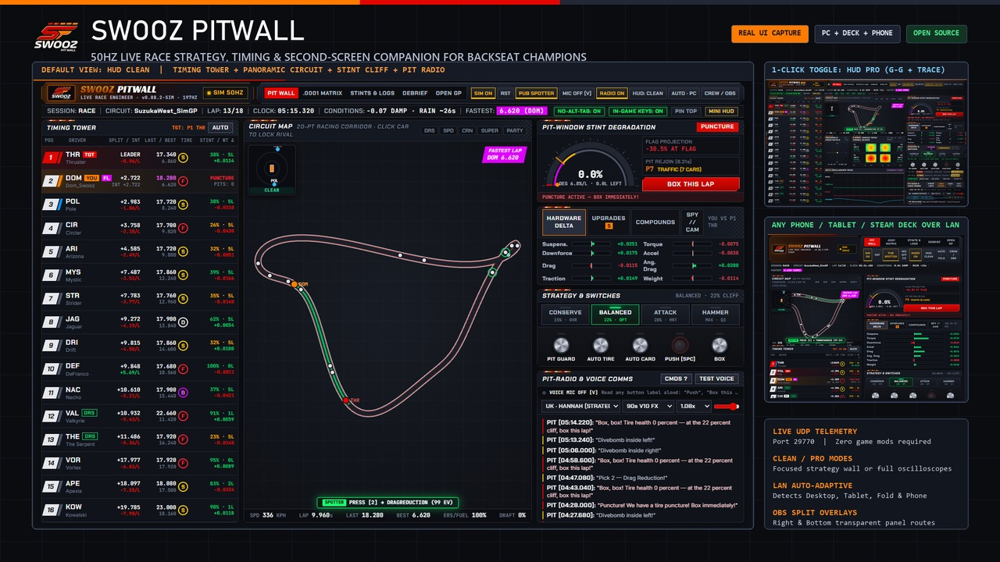
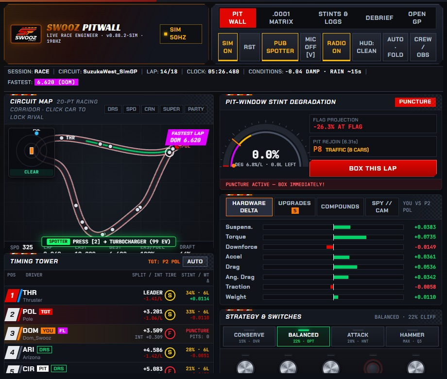

# SWOOZ PitWall

Live pit wall dashboard and voice race engineer for [Backseat Champions](https://store.steampowered.com/app/2174510/Backseat_Champions/). Built to run on Windows desktops, Steam Deck (SteamOS / Linux), phones, foldables, tablets, and OBS browser sources over your local Wi-Fi.




## What It Does

Backseat Champions exposes a local 50Hz UDP telemetry and command stream on ports `29770` and `29771`. PitWall listens to those packets without touching any game files and renders a live strategy wall in any modern browser.

- **Clean Default Layout (`HUD: CLEAN`)**: Keeps the main screen focused on the 16-car timing tower, circuit map with live racing gaps, tire cliff projection, hardware delta bars, pit strategy switches, and the pit radio log.
- **Full Telemetry Mode (`HUD: PRO`)**: Click `HUD: CLEAN` in the top bar (or press/say `Pro Mode`) anytime you want the G-force reticle, 4-wheel thermal patches, multi-channel oscilloscope trace, and the top LED shift light.
- **Works Across Devices (`AUTO`)**: Automatically adapts between desktop, foldable/tablet split layouts, and single-hand portrait phones. You can lock any layout manually with the top-right `AUTO` toggle, and scan the LAN QR modal from another device on the same network.
- **Local Pit Radio & Voice Comms**: Includes multiple engineer voices with optional pit-radio EQ, browser SpeechSynthesis fallback on Linux/SteamOS, and push-to-talk / hands-free voice triggers (`[V]`) for calling strategy buttons out loud.
- **In-Game Global Hotkeys & Floating Mini-HUD**: Optional Windows global hotkeys (`F5` Push, `F6` Box This Lap, `F7` Auto Card, `F8` Sitrep, `Numpad 1-3` Cards, `Numpad 9` Mini-HUD) so you do not have to alt-tab mid-stint.
- **Custom Crew Packs & OBS Overlays**: Import/export custom `.zip` engineer voice packs, or add `?obs=1` and `?obs_panel=right` / `?obs_panel=bottom` in OBS Studio for transparent broadcast strips.

---

## Screenshots

| Clean Cockpit (Default) | Pro Telemetry Toggle | Tablet / Foldable Responsive View |
|---|---|---|
|  |  |  |

---

## Quick Start

### Windows

1. Download or clone this repository (or grab `SWOOZ_PitWall_Community_Edition.zip`).
2. Start Backseat Champions and make sure **Telemetry Out (`127.0.0.1:29770`)** and **Commands In (`127.0.0.1:29771`)** are enabled in game settings.
3. Run `SWOOZ_PitWall.bat` (or `python server.py`).
4. Open `http://127.0.0.1:8765` on your PC, or open the printed LAN address on any phone or tablet on the same Wi-Fi.

### Steam Deck (SteamOS / Desktop Mode)

```bash
git clone https://github.com/DOMSWOOZ/swooz-pitwall.git
cd swooz-pitwall
./start_pitwall_steamos.sh
```

If you already cloned earlier, pull the latest changes inside `swooz-pitwall` first (`git pull && ./start_pitwall_steamos.sh`).

When Backseat Champions runs on the Steam Deck, keep its UDP target at `127.0.0.1:29770` and open the LAN IP URL printed in Konsole (`http://<deck-ip>:8765`) on your phone or tablet. PitWall automatically echoes UDP race commands back to the active local target cleanly.

---

## Build & Workflow Notes

This project was designed, visual-directed, and tested by **DOMSWOOZ** ([twitch.tv/dom_swooz](https://www.twitch.tv/dom_swooz)) for personal play, second-screen experimentation, and the Backseat Champions community. Coding, telemetry parsing refactors, and layout iterations were built using an AI-assisted workflow with LLM coding tools under direct human direction, layout review, and live race testing.

MIT License. Built around the official Backseat Champions public UDP API.
